# Analytics (cookieless PostHog)

> **TL;DR** — The site runs **cookieless PostHog** (the team calls it "Pulse Talk"). No cookie
> banner, EU-hosted. It captures page opens, session duration, load performance, heatmaps, errors,
> and a small set of typed product events. To activate it, set `NEXT_PUBLIC_POSTHOG_KEY`. To add an
> event, edit `lib/analytics/events.ts` and call `track()`.

- **Project:** `220518` · **Region:** EU (`eu.i.posthog.com`) · **App UI:** `https://eu.posthog.com`
- **Posture:** cookieless-by-default, autocapture off, session replay off, no consent banner.

## Why cookieless

`persistence: 'memory'` + `cookieless_mode: 'always'` means **nothing is written to or read from the
device**. Under ePrivacy Art. 5(3), storage that isn't strictly necessary is what triggers a cookie
banner — we store nothing, so **no banner is required**. Visitors are anonymous: PostHog derives a
transient, server-side daily-salt hash instead of a device ID, so there is no cross-session identity.
This keeps the funnel measurable without the consent-gate friction that tanks conversion.

The trade-off: no cross-visit retention, no lead-level attribution, no session replay. Those need an
identified/consented tier, which is deliberately **not** wired here.

## What gets captured

| Signal | Event | How it works |
| --- | --- | --- |
| **Page opens** | `$pageview` | Fired on first load **and** every App Router client navigation (`PostHogPageView`). |
| **Session duration / bounce** | `$pageleave` | PostHog pairs pageview→pageleave per session to compute time-on-page, session duration, and bounce rate. |
| **Load performance** | `$web_vitals` | LCP / CLS / INP / FCP per page open (`capture_performance`). No PII. |
| **Heatmaps** | `$heatmap` | Cookieless coordinate stream (clicks/scroll positions) — no element text, no PII. |
| **Errors** | `$exception` | Uncaught errors + unhandled rejections auto-captured; React render errors reported from the error boundaries. |
| **Product events** | see [taxonomy](#event-taxonomy) | Typed `track()` calls (`tab_switched`, `checklist_item_toggled`, …). |

> **Sessions in a SPA.** This is a single-page app: client navigations keep the same JS context, so
> the in-memory session persists across route changes within a visit. A full page reload starts a new
> cookieless session — expected for this posture.

## How the data flows

```mermaid
flowchart LR
  subgraph Browser
    P[PostHogProvider<br/>boots after hydration] --> C[lib/analytics/client.ts<br/>cookieless init]
    PV[PostHogPageView<br/>route change] -->|$pageview| C
    UI[UI components<br/>track&#40;&#41;] -->|typed events| C
    EB[error.tsx /<br/>global-error.tsx] -->|captureException| C
    C -->|beforeSend<br/>noise filter| Q{key set?}
  end
  Q -->|no| X[no-op<br/>0 bytes shipped]
  Q -->|yes, direct| EU[(PostHog EU<br/>project 220518)]
  Q -->|yes, /ingest| RW[Next.js rewrite<br/>same-origin] --> EU
```



## Architecture

The analytics **port** is the only place that touches the PostHog SDK. Components import typed helpers,
never `posthog-js` directly — so swapping providers is a one-file change and static pages stay lean.

| File | Responsibility |
| --- | --- |
| `lib/analytics/events.ts` | Frozen event taxonomy (`EVENTS`) + `EventProps`. Single source of truth. |
| `lib/analytics/client.ts` | Cookieless init, heatmaps/web-vitals/errors, `beforeSend` noise filter, `track()`, `captureException()`. |
| `lib/analytics/index.ts` | Barrel — the only import surface for components. |
| `app/PostHogProvider.tsx` | Boots the SDK after hydration (own async chunk, off the critical path). |
| `app/PostHogPageView.tsx` | Fires `$pageview` on navigation (Suspense-wrapped so pages stay static). |
| `app/TrackView.tsx` | Fire-once view event for Server Component pages (e.g. `deep_dive_view`). |
| `app/error.tsx` / `app/global-error.tsx` | Report render errors that React swallows in production. |
| `scripts/event-lint.mjs` | Build gate: rejects unknown event names and PII-looking keys. |

**Bundle behaviour:** `posthog-js` is dynamically imported, so it lands in its own lazy chunk after
hydration. With **no key set it is dead-code-eliminated to zero bytes** — analytics off costs nothing.

## Event taxonomy

Defined in `lib/analytics/events.ts`. Naming is `object_action`, snake_case, past tense (present tense
for views). **No PII** in names or property keys — enforced by `pnpm event-lint`.

| Event | Props | Fired when |
| --- | --- | --- |
| `tab_switched` | `tab` | User switches Learn ↔ Hack |
| `checklist_item_toggled` | `phase`, `checked` | A checklist item is ticked/unticked |
| `checklist_phase_completed` | `phase` | A toggle completes every item in a phase |
| `custom_todo_added` | `phase` | User adds their own todo |
| `checklist_reset` | `scope` | Progress is reset |
| `deep_dive_view` | `slug` | A deep-dive article opens |
| `theme_toggled` | `theme` | Light/dark switch |

## How-to: add a new event

1. Add the name to `EVENTS` **and** `CLIENT_EVENTS` in `lib/analytics/events.ts`; add any new property
   to `EventProps` (snake_case, no PII).
2. Fire it via the typed helper — never the raw SDK:

   ```ts
   import { track } from "@/lib/analytics";
   void track("your_event", { phase: 2 });
   ```

   For a Server Component page, drop in `<TrackView event="your_event" props={{ ... }} />`.
3. Run the gate:

   ```bash
   pnpm event-lint   # taxonomy + PII check
   pnpm lint && pnpm typecheck
   ```

4. Verify it lands in project 220518 (Activity → Explore).

**Cookieless invariants — do not change in `client.ts`:** `autocapture: false`,
`persistence: 'memory'`, `cookieless_mode: 'always'`, `disable_session_recording: true`. Enabling
replay or an identified tier requires a real consent flow first.

## Setup and configuration

### Environment variables

| Variable | Scope | Purpose |
| --- | --- | --- |
| `NEXT_PUBLIC_POSTHOG_KEY` | browser | Project (ingestion) key `phc_…`. **Empty disables analytics.** Write-only, browser-safe. |
| `NEXT_PUBLIC_POSTHOG_HOST` | browser | `https://eu.i.posthog.com` (direct) or `/ingest` (proxy). |
| `POSTHOG_API_KEY` | build only | Personal key (Error-tracking **write**) for source-map upload. **Secret** — never `NEXT_PUBLIC_`. |
| `POSTHOG_PROJECT_ID` | build only | `220518`. Used by the source-map uploader. |

Locally, copy `.env.example` → `.env.local` and paste the key. In production, set the same vars in
**Vercel → Settings → Environment Variables** (Production + Preview).

### Error tracking + readable stack traces

`capture_exceptions` auto-captures uncaught errors and unhandled rejections. Because React swallows
render errors in production, `app/error.tsx` (route segments) and `app/global-error.tsx` (root layout)
call `captureException()` to close that gap. Production stack traces are minified until source maps are
uploaded — set `POSTHOG_API_KEY` + `POSTHOG_PROJECT_ID` in the Vercel build env and `next.config.ts`
uploads (and deletes) maps on each build.

### Ad-blocker-resistant proxy (optional, no DNS)

Roughly a third of visitors block `eu.i.posthog.com` directly. The `/ingest` rewrite in
`next.config.ts` proxies ingestion through the app's own origin. It's **wired but dormant** — flip it
on by setting `NEXT_PUBLIC_POSTHOG_HOST=/ingest` (locally and in Vercel). It's a same-origin path, so
**no DNS or subdomain is required**. The source-map uploader automatically falls back to the real
PostHog host when the value is a path.

## Querying analytics from Claude Code

The repo ships a project-scoped **PostHog MCP** (`.mcp.json`) and a **`pulse` skill**
(`.claude/skills/pulse/`). Run `/mcp` and complete the browser login, then ask for pageviews, session
duration, top errors, or a HogQL query — scoped to project 220518. See the skill for query patterns.

## Related

- `.env.example` — required environment variables
- `.claude/skills/pulse/SKILL.md` — analytics workflows for agents
- `lib/analytics/` — the analytics port (implementation)
