# Analytics (cookieless PostHog)

> **TL;DR** — The site runs **cookieless PostHog** (the team calls it "Pulse Talk"). No cookie
> banner, EU-hosted. It captures page opens, session duration, load performance, heatmaps, errors,
> and a small set of typed product events. To activate it, set `NEXT_PUBLIC_POSTHOG_KEY`. To add an
> event, edit `lib/analytics/events.ts` and call `track()`.

- **Project:** `220518` · **Region:** EU (`eu.i.posthog.com`) · **App UI:** `https://eu.posthog.com`
- **Posture:** cookieless-by-default, autocapture off, session replay off, no consent banner.

## Why cookieless

`persistence: 'memory'` + `cookieless_mode: 'always'` means **nothing is written to or read from the
device**. Under ePrivacy Art. 5(3), storage that isn't strictly necessary is what triggers a cookie
banner — we store nothing, so **no banner is required**. Visitors are anonymous: PostHog derives a
transient, server-side daily-salt hash instead of a device ID, so there is no cross-session identity.
This keeps the funnel measurable without the consent-gate friction that tanks conversion.

The trade-off: no cross-visit retention, no lead-level attribution, no session replay. Those need an
identified/consented tier, which is deliberately **not** wired here.

**URL/PII safety.** PostHog sends the full `location.href` as `$current_url` (plus referrer and the
heatmap URL key). A link like `/?email=alice@example.com#token` would otherwise leak PII, so
`beforeSend` (in `client.ts`) strips the fragment and drops every query param outside an allowlist
(`utm_*`, `ref`, `tab`, `phase`) from all URL-bearing properties and heatmap keys, with
`mask_personal_data_properties` on as defense in depth.

## What gets captured

| Signal | Event | How it works |
| --- | --- | --- |
| **Page opens** | `$pageview` | Fired on first load and on every real **path** navigation (`PostHogPageView`). Tab/phase changes live in the query string and intentionally do **not** count as new page opens. |
| **Session duration / bounce** | `$pageleave` | PostHog pairs pageview→pageleave per session to compute time-on-page, session duration, and bounce rate. |
| **Load performance** | `$web_vitals` | LCP / CLS / INP / FCP per page open (`capture_performance`). No PII. |
| **Heatmaps** | `$heatmap` | Cookieless coordinate stream (clicks/scroll positions) — no element text, no PII. |
| **Errors** | `$exception` | Uncaught errors + unhandled rejections auto-captured; React render errors reported from the error boundaries. |
| **Product events** | see [taxonomy](#event-taxonomy) | Typed `track()` calls (`tab_switched`, `checklist_item_toggled`, …). |

> **Sessions in a SPA.** This is a single-page app: client navigations keep the same JS context, so
> the in-memory session persists across route changes within a visit. A full page reload starts a new
> cookieless session — expected for this posture.

## How the data flows

```mermaid
flowchart LR
  subgraph Browser
    P[PostHogProvider<br/>boots after hydration] --> C[lib/analytics/client.ts<br/>cookieless init]
    PV[PostHogPageView<br/>route change] -->|$pageview| C
    UI[UI components<br/>track&#40;&#41;] -->|typed events| C
    EB[error.tsx /<br/>global-error.tsx] -->|captureException| C
    C -->|beforeSend<br/>noise filter| Q{key set?}
  end
  Q -->|no| X[no-op<br/>0 bytes shipped]
  Q -->|yes, direct| EU[(PostHog EU<br/>project 220518)]
  Q -->|yes, /ingest| RW[Next.js rewrite<br/>same-origin] --> EU
```



## Architecture

The analytics **port** is the only place that touches the PostHog SDK. Components import typed helpers,
never `posthog-js` directly — so swapping providers is a one-file change and static pages stay lean.

| File | Responsibility |
| --- | --- |
| `lib/analytics/events.ts` | Frozen event taxonomy (`EVENTS`) + `EventProps`. Single source of truth. |
| `lib/analytics/client.ts` | Cookieless init, heatmaps/web-vitals/errors, `beforeSend` noise filter, `track()`, `captureException()`. |
| `lib/analytics/index.ts` | Barrel — the only import surface for components. |
| `app/PostHogProvider.tsx` | Boots the SDK after hydration (own async chunk, off the critical path). |
| `app/PostHogPageView.tsx` | Fires `$pageview` on **path** navigations only (depends on `pathname`, not search params — so tab/phase `replaceState` writes don't inflate pageviews). |
| `app/TrackView.tsx` | Fire-once view event for Server Component pages (e.g. `deep_dive_view`). |
| `app/TrackClicks.tsx` | Delegated `data-cta` → `cta_click` listener (declarative CTA tracking). |
| `app/error.tsx` / `app/global-error.tsx` | Report render errors that React swallows in production. |
| `scripts/event-lint.mjs` | Build gate: rejects unknown event names and PII-looking keys. |

**Bundle behaviour:** `posthog-js` is dynamically imported, so it lands in its own lazy chunk after
hydration. With **no key set it is dead-code-eliminated to zero bytes** — analytics off costs nothing.

## Event taxonomy

Defined in `lib/analytics/events.ts`. Naming is `object_action`, snake_case, past tense (present tense
for views). **No PII** in names or property keys — enforced by `pnpm event-lint`.

| Event | Props | Fired when |
| --- | --- | --- |
| `tab_switched` | `tab` | User switches Learn ↔ Hack |
| `checklist_item_toggled` | `phase`, `checked` | A checklist item is ticked/unticked |
| `checklist_phase_completed` | `phase` | A toggle completes every item in a phase |
| `custom_todo_added` | `phase` | User adds their own todo |
| `checklist_reset` | `scope` | Progress is reset |
| `deep_dive_view` | `slug` | A deep-dive article opens |
| `theme_toggled` | `theme` | Light/dark switch |
| `cta_click` | `location`, `target` | Any element with `data-cta` is clicked (declarative — see below) |

## How-to: add a new event

1. Add the name to `EVENTS` **and** `CLIENT_EVENTS` in `lib/analytics/events.ts`; add any new property
   to `EventProps` (snake_case, no PII).
2. Fire it via the typed helper — never the raw SDK:

   ```ts
   import { track } from "@/lib/analytics";
   void track("your_event", { phase: 2 });
   ```

   For a Server Component page, drop in `<TrackView event="your_event" props={{ ... }} />`.
3. Run the gate:

   ```bash
   pnpm event-lint   # taxonomy + PII check
   pnpm lint && pnpm typecheck
   ```

4. Verify it lands in project 220518 (Activity → Explore).

**Cookieless invariants — do not change in `client.ts`:** `autocapture: false`,
`persistence: 'memory'`, `cookieless_mode: 'always'`, `disable_session_recording: true`. Enabling
replay or an identified tier requires a real consent flow first.

## Helpers (the analytics port API)

Import everything from `@/lib/analytics` — never `posthog-js` directly. This is the full surface for
event-driven work; you rarely need more than `track()`.

| Helper | Use it for |
| --- | --- |
| `track(event, props)` | Fire a typed product event from a Client Component. Unknown names are ignored (and warn in dev). |
| `<TrackView event props />` | Fire a one-off view event from a **Server Component** page (e.g. `deep_dive_view`) without making it a client component. |
| `data-cta="label"` (+ `<TrackClicks/>`) | **Declarative** CTA tracking. Add the attribute to any element; the delegated listener mounted in `PostHogProvider` fires `cta_click`. No import, no wiring. |
| `captureException(error, ctx)` | Report a caught error to Error Tracking. Used by the error boundaries; call it from your own `try/catch` when you swallow an error. |
| `getFlag(key)` | Read a PostHog **feature flag** (cookieless-safe) — the basis for future A/B tests and gradual rollouts. |
| `capturePageview()` | Manual pageview. Already wired globally; you won't normally call it. |

### Declarative CTA example

```tsx
// Any element — link or button. No import needed.
<a href="/deep-dives" data-cta="home-deep-dives">Read the deep dives</a>
```

This emits `cta_click` with `location: "home-deep-dives"` and `target: "/deep-dives"`. Prefer this
over hand-wiring `onClick={() => track("cta_click", …)}` for navigational CTAs.

## What to capture (and what not to)

The goal is a small set of **decision-driving** events, not telemetry for its own sake. Before adding
an event, ask: *what decision would this change?* If nothing, don't capture it.

**Principles**

- **Funnel milestones over micro-interactions.** `checklist_phase_completed` tells you more than
  logging every scroll. Capture the steps of the journey you want to improve.
- **One event, rich properties.** Prefer `checklist_item_toggled { phase, checked }` over five
  per-phase event names. Properties are free to break down in analysis; new event names are not.
- **Never PII.** No email/name/phone/IP in names or props. Heatmaps and web vitals are already
  PII-free. `event-lint` blocks violations at build time.
- **Idempotent milestones.** Fire completion/conversion events on the *transition* only (see the
  phase-completion guard in `Guidebook.tsx`), so counts aren't inflated by re-renders.

**Recommended events to add as the product grows** (already easy with the helpers above):

| Candidate event | Props | Why it's worth capturing |
| --- | --- | --- |
| `cta_click` (live) | `location`, `target` | Which CTAs actually get clicked — add `data-cta` to hero/nav/footer CTAs. |
| `phase_opened` | `phase`, `tab` | Entry funnel per phase — where people start and drop off. |
| `guide_completed` | — | The top-line success metric: someone finished every checklist. |
| `outbound_link_click` | `location`, `target` | Which external references pull people off-site. |
| `search_performed` | `has_results` | If/when search ships — intent signal, no query text (PII-safe). |
| `share_clicked` | `channel` | Virality/word-of-mouth loop. |

To add any of these: extend `EVENTS`/`EventProps` in `events.ts`, fire via `track()` (or `data-cta`),
run `pnpm event-lint`.

**Later tiers (out of scope today, seams exist):**

- **Server-side conversion events** — when a backend exists, capture un-spoofable conversions with
  `posthog-node` (`flushAt:1`, wrap in `waitUntil`). No server runtime here yet, so this is a note,
  not code.
- **Identified / session-replay tier** — requires a real consent flow first; the cookieless base tier
  must stay banner-free.

## Analyzing the data

Everything below lives in the PostHog app (project 220518) or is reachable from Claude Code via the
**PostHog MCP** — ask in natural language and it runs the query for you.

| Question | Where / how |
| --- | --- |
| Traffic, top pages, session duration, bounce | **Web Analytics** dashboard (auto from `$pageview`/`$pageleave`). |
| Load performance (LCP/CLS/INP) | **Web Vitals** insight (auto from `$web_vitals`). |
| Where people drop off | **Funnel** insight: e.g. `$pageview` → `tab_switched(hack)` → `checklist_item_toggled` → `checklist_phase_completed`. |
| Which phases get completed most | **Breakdown** on `checklist_phase_completed` by the `phase` property, or HogQL. |
| Where users click / scroll | **Heatmaps** via the PostHog Toolbar on the live site. |
| Top production errors | **Error tracking** (stack traces readable once source maps upload). |
| Anything ad-hoc | **HogQL** (SQL over the events table). |

**HogQL example — checklist completion by phase, last 30 days:**

```sql
select properties.phase as phase, count() as completions
from events
where event = 'checklist_phase_completed' and timestamp > now() - interval 30 day
group by phase
order by phase
```

**From Claude Code:** run `/mcp`, log in, then ask e.g. *"show pageviews and session duration for the
last 7 days in project 220518"* or *"top 5 errors this week"*. The `pulse` skill documents more query
patterns and guards the cookieless invariants.

## Setup and configuration

### Environment variables

| Variable | Scope | Purpose |
| --- | --- | --- |
| `NEXT_PUBLIC_POSTHOG_KEY` | browser | Project (ingestion) key `phc_…`. **Empty disables analytics.** Write-only, browser-safe. |
| `NEXT_PUBLIC_POSTHOG_HOST` | browser | `https://eu.i.posthog.com` (direct) or `/ingest` (proxy). |
| `POSTHOG_API_KEY` | build only | Personal key (Error-tracking **write**) for source-map upload. **Secret** — never `NEXT_PUBLIC_`. |
| `POSTHOG_PROJECT_ID` | build only | `220518`. Used by the source-map uploader. |

Locally, copy `.env.example` → `.env.local` and paste the key. In production, set the same vars in
**Vercel → Settings → Environment Variables** (Production + Preview).

### Error tracking + readable stack traces

`capture_exceptions` auto-captures uncaught errors and unhandled rejections. Because React swallows
render errors in production, `app/error.tsx` (route segments) and `app/global-error.tsx` (root layout)
call `captureException()` to close that gap. Production stack traces are minified until source maps are
uploaded — set `POSTHOG_API_KEY` + `POSTHOG_PROJECT_ID` in the Vercel build env and `next.config.ts`
uploads (and deletes) maps on each build.

### Ad-blocker-resistant proxy (optional, no DNS)

Roughly a third of visitors block `eu.i.posthog.com` directly. The `/ingest` rewrite in
`next.config.ts` proxies ingestion through the app's own origin. It's **wired but dormant** — flip it
on by setting `NEXT_PUBLIC_POSTHOG_HOST=/ingest` (locally and in Vercel). It's a same-origin path, so
**no DNS or subdomain is required**. When you enable it, also add `skipTrailingSlashRedirect: true` to
`next.config.ts` (PostHog's POSTs must keep their trailing slashes) — it's left off by default because,
as a global flag, it would disable trailing-slash canonicalization for the whole site. The source-map
uploader automatically falls back to the real PostHog host when the value is a path.

## Querying analytics from Claude Code

The repo ships a project-scoped **PostHog MCP** (`.mcp.json`) and a **`pulse` skill**
(`.claude/skills/pulse/`). Run `/mcp` and complete the browser login, then ask for pageviews, session
duration, top errors, or a HogQL query — scoped to project 220518. See the skill for query patterns.

## Related

- `.env.example` — required environment variables
- `.claude/skills/pulse/SKILL.md` — analytics workflows for agents
- `lib/analytics/` — the analytics port (implementation)
